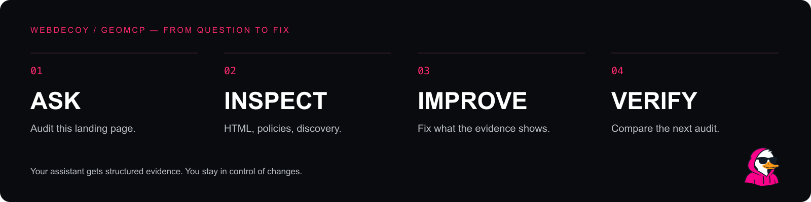

<p align="center">
  
</p>

<p align="center">
  <a href="https://github.com/WebDecoy/geomcp/actions/workflows/ci.yml"></a>
  <a href="LICENSE"></a>
  
  <a href="https://modelcontextprotocol.io/"></a>
</p>

<h1 align="center">Your next SEO fix starts in the conversation.</h1>

<p align="center">Ask your AI assistant to inspect a page. Get the evidence, the missing pieces,<br />and a practical plan to make your site easier to discover and understand.</p>

<p align="center"><a href="#get-started">Get started</a> · <a href="#five-tools-one-workflow">Tools</a> · <a href="#what-it-checks">Checks</a> · <a href="#understand-the-score">Methodology</a> · <a href="CONTRIBUTING.md">Contribute</a></p>

---

**GEOMCP** is an open-source Model Context Protocol server for technical SEO and generative engine optimization (GEO). Connect it to an MCP-capable assistant to inspect HTML, structured data, crawler policies and sitemap documents without leaving your development workflow.

Every page finding includes a stable check ID, observed evidence and a concrete recommendation. Audit reports work as structured JSON, so your assistant can turn findings into code changes and compare the result.

- **Evidence you can inspect.** Findings point to observed metadata, elements, counts and response details.
- **Works on your machine.** No GEOMCP account, API key, telemetry or paid LLM dependency.
- **Useful before launch.** Audit supplied HTML without making network requests.
- **Search and training stay distinct.** Inspect declared crawler policies without treating training opt-outs as SEO failures.
- **Designed for a second pass.** Compare checks after changes; unknowns remain coverage changes.



## Get started

Requires **Node.js 22+**, npm and Git. This initial release is distributed through GitHub; an npm registry release is not required.

```bash
git clone https://github.com/WebDecoy/geomcp.git
cd geomcp
npm ci
npm run build
node dist/cli.js --help
```

Use the **absolute path** to `dist/cli.js` in your MCP client. The server communicates over stdio and waits for an MCP client when started without arguments.

### Claude Desktop or Cursor

Add this entry to your client's MCP configuration (`claude_desktop_config.json` for Claude Desktop; `.cursor/mcp.json` for a Cursor project). Replace the example path with your actual clone location, then restart or enable the server.

```json
{
  "mcpServers": {
    "geomcp": {
      "command": "node",
      "args": ["/absolute/path/to/geomcp/dist/cli.js"]
    }
  }
}
```

If your desktop app cannot find Node, use the absolute path returned by `which node` (macOS/Linux) or `where node` (Windows) as `command`.

### VS Code

In `.vscode/mcp.json`:

```json
{
  "servers": {
    "geomcp": {
      "type": "stdio",
      "command": "node",
      "args": ["/absolute/path/to/geomcp/dist/cli.js"]
    }
  }
}
```

### Start with a question

> Audit https://your-site.com/guide for technical GEO issues. Show the evidence for the three most useful fixes, inspect its robots policy, and propose specific changes.

> Audit this generated HTML before I deploy it. Keep unavailable HTTP checks separate from failures.

> Compare these two GEOMCP reports. What improved, what regressed, and what could we not evaluate?

The included **`improve-page` prompt** guides the audit → fix plan → verification workflow. **`geomcp://methodology`** exposes scoring guidance directly to clients that support MCP resources.

## Five tools, one workflow

| Tool | Input | Result |
| --- | --- | --- |
| `audit_url` | `url` | Fetch one public HTML page; return scored checks, evidence, coverage and up to eight prioritized fixes. |
| `audit_html` | `html`, `url` | Analyze supplied HTML offline. The URL resolves relative links; no request is made. |
| `inspect_robots` | `url` | Fetch the origin's `/robots.txt`; evaluate declared policies for the exact page path. |
| `inspect_sitemap` | `url` | Inspect one XML sitemap or sitemap index for syntax, locations, dates and duplicates. |
| `compare_audits` | `before`, `after` | Compare check statuses from two reports using the same rules version. |

`audit_url`, `inspect_robots` and `inspect_sitemap` make public GET requests. The other tools run offline. All tools are read-only: they do not edit your files or deploy changes.

## What it checks

**26 page checks across seven categories.** Rules are readable in [`src/audit.ts`](src/audit.ts); the complete check IDs and weights are in [`docs/checks.md`](docs/checks.md).

| Category | Signals inspected |
| --- | --- |
| Discovery | Title, page description, canonical URL, index directives, Open Graph metadata |
| Structure | Document language, primary heading, heading order, main landmark, extractable HTML text |
| Semantics | JSON-LD syntax, entity types and contexts, publisher identity metadata |
| Media & interaction | Image alt attributes, table headers, form labels |
| Links | Internal links, descriptive labels, HTML navigation destinations |
| Evidence signals | Author attribution, machine-readable dates, supporting source links |
| Delivery | HTTP status, HTML Content-Type, HTTPS URL, responsive viewport |

Robots inspection reports policies for Googlebot, Bingbot, OAI-SearchBot, ChatGPT-User, Claude-SearchBot, Claude-User, PerplexityBot, GPTBot and ClaudeBot. These are **declared policies**, not live requests made under those identities.

### An actual report

[`examples/audit.json`](examples/audit.json) is generated from the included [`examples/page.html`](examples/page.html) fixture. It is a reproducible example, not a customer result.

```json
{
  "id": "canonical-url",
  "category": "discovery",
  "status": "warn",
  "weight": 2,
  "title": "Canonical URL",
  "evidence": "0 canonical elements; resolved URL: none",
  "recommendation": "Use one HTTP(S) canonical URL for the preferred version of this page."
}
```

You can also use the audit engine directly after building:

```js
import { auditHTML } from './dist/index.js';

const report = auditHTML(html, 'https://example.com/guide');
console.log(report.priorities);
```

## Understand the score

The score is a **transparent technical checklist**, with rules version `0.1.0`:

```text
pass = 1    warn = 0.5    fail = 0
score = round(100 × Σ(weight × value) / Σ(evaluated weights))
unknown checks are excluded
```

Core checks receive weights of 2 or 3; supporting checks receive 1. Reports include coverage and category scores so a high score with sparse evidence remains visible. Compare similar page types, coverage and the same rules version.

A checklist score does **not** predict AI citations, rankings, factual accuracy or signups. A public product page, private dashboard and editorial article have different needs. Intentional `noindex`, absent bylines and missing editorial dates can all be appropriate. No recommendation requires invented content, credentials, claims or reviews.

## Network behavior & privacy

- Runs locally. No telemetry, vendor API or account system. Reports are returned to the MCP client; your assistant provider's own data policies still apply.
- Public fetches identify as `GEOMCP/0.1 (+https://github.com/WebDecoy/geomcp)`. It does not impersonate AI vendors.
- HTTP(S) only, ports 80/443, a 15-second total fetch deadline, four redirects maximum and a 2 MiB response limit. The same size limit applies to offline HTML input.
- Private, loopback, link-local and reserved IP ranges are blocked. DNS answers are checked and pinned to each connection; redirects are revalidated. HTTPS downgrades are blocked.
- No cookies, authentication headers, form submissions, JavaScript execution or browser automation. Requests ask for uncompressed content; unexpectedly compressed responses are rejected.
- `audit_url` fetches one page and does not enforce robots.txt policy automatically. Use it on pages you are authorized to inspect; use `inspect_robots` when reviewing declared crawler preferences.
- Page content is untrusted data. MCP tool descriptions and server instructions tell assistants to treat it as evidence, never as instructions.

The tool does not measure Core Web Vitals, computed visibility, rendered accessibility, actual crawler identity or index inclusion. Sitemaps and outbound links are inspected without following their destinations. Supporting links are evidence signals, not fact checking.

## Development

```bash
npm ci
npm run build
npm test
npm run check
npm run artwork
```

Tests cover audit behavior, scoring, crawler rules, XML parsing, SSRF protections and a real MCP client/server stdio exchange. GitHub Actions runs the build and tests on Node.js 22 and 24. Artwork is generated from the editable SVG designs in `scripts/artwork.mjs`.

See [CONTRIBUTING.md](CONTRIBUTING.md) for adding checks and [SECURITY.md](SECURITY.md) for private vulnerability reports.

## Built by WebDecoy

[WebDecoy](https://webdecoy.com/?utm_source=github&utm_medium=readme&utm_campaign=geomcp) builds bot detection for websites, applications, WordPress and Shopify. GEOMCP helps developers inspect discoverability; WebDecoy helps them understand the traffic that arrives.

If GEOMCP helps you ship a better page, **[give it a star](https://github.com/WebDecoy/geomcp)** or share a reproducible issue. Contributions and thoughtful new checks are welcome.

[MIT licensed](LICENSE). Made for people who want to see the work behind the score.
